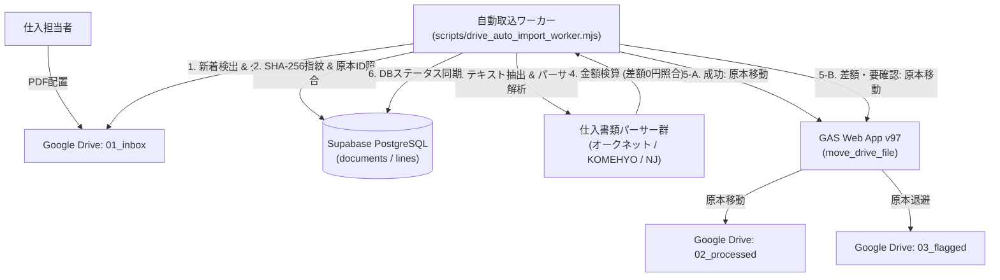

# Google Drive 仕入書類 自動取込ワーカー仕様書 (DRIVE_AUTO_IMPORT_WORKER.md)

B.I.S EC における仕入書類（オークネット・KOMEHYO・ネットジャパン等）を Google Drive から一括検知し、書類DBへの登録・明細抽出・金額検算・完了フォルダへの原本移動を自律実行するワーカーの仕様および運用手順書です。

---

## 1. システム構成と責務分離



### コピーゼロ原本管理 & 厳格なサーバー側API統一
- アップロード処理等で原本ファイルの複製（不要なコピー）を作成せず、**Google Drive上にアップロードされた既存原本ID（`drive_file_id`）** を直接 `documents` テーブルへ紐付けます。
- **公開用キー（anon key）を用いた直接のPostgREST INSERT/PATCHは完全禁止**: Git管理のRLSおよびセキュリティ設計に厳格準拠し、すべてのDBアクセスは権限を持つサーバー側API（`documents-relay` Edge Function）を経由します。
- 原本の実態移動は GAS Web App v97（スクリプト所有者権限）経由で Drive フォルダ間を移動させます。

---

## 2. 実行環境と前提条件

- **ランタイム**: Node.js v18 以上 (ES Modules 対応)
- **依存モジュール**: `pdf-parse` (`package.json` に正規登録済み)
- **連携サービス**:
  - Google Drive API v3 (ファイル一覧取得・原本取得)
  - Google Apps Script Web App v97 (DriveAppによる権限昇格フォルダ移動)
  - Supabase Edge Functions (`documents-relay`: サーバー側権限によるDB安全更新)

---

## 3. 使用フォルダ構成と対応書式

### 使用フォルダ構成
| フォルダ名 | 役割 | フォルダID (本番管理用) |
| :--- | :--- | :--- |
| **01_inbox** | 担当者が仕入書類PDFを投入する監視対象フォルダ | `1ctLRUQbwINARCDuGdYnpkrCkkK287HV5` |
| **02_processed** | 金額検算が完全一致（差額0円）し、明細保存が完了した原本の保管先 | `1MUpsttOl2MY1Q8QAptSX_1vBGjl_aXY3` |
| **03_flagged** | 金額不一致、文字層なし（画像スキャン）、未知の書式等の要確認原本退避先 | `1kgnzKvslB0J2Mq8ZM8-PqsTjret1CQ3E` |

> ※商品画像用フォルダ（`1_kE1qM-rT2h4Ue9j9L8i5v7A_EXAMPLE`等）は本パイプラインの監視対象外です。

### 仕入書類パーサーの対応状況（現行実装の仕様）
全件一括投入は行わず、実測検証済みの書式から対象1件ごとの限定運用を行います。

- **ネットジャパン (NJ)**:
  - **複合票 (566型)**: **動的抽出に対応**。売上相殺（負数）・買上・手数料・雑費の全セクション動的抽出、参照ページ動的判定、最大剰余方式の符号拡張（差額0円検算一致）。
  - **単票 (10773型)**: **動的抽出に対応**。買上・雑費のセクション動的抽出、参照ページ動的判定（差額0円検算一致）。
- **オークネット (466935型)**:
  - **代表原本の固定明細に対応**（466935原本の支払・請求項目を固定定義。動的抽出済みではなく、レイアウトや行数が異なる別日書類は未対応）。
- **KOMEHYO (2764型)**:
  - **代表原本の固定明細に対応**（2764原本の商品12件・事務費1件を固定定義。動的抽出済みではなく、レイアウトや行数が異なる別日書類は未対応）。

---

## 4. 必要な環境変数

本スクリプトは秘密情報をコードに含めず、環境変数（または `.env`）から動的に読み込みます。

| 環境変数名 | 必須 | 説明 | 設定例 |
| :--- | :---: | :--- | :--- |
| `GOOGLE_ACCESS_TOKEN` | 任意※ | Drive API 呼び出し用のOAuth2アクセストークン | `ya29.a0A...` (未設定時は `~/.clasprc.json` から自動ロード) |
| `GAS_WEB_APP_URL` | 必須 | GAS固定Web App URL (v97配信版) | `https://script.google.com/macros/s/AKfyc.../exec` |
| `VITE_PUBLIC_SUPABASE_URL` | 必須 | Supabase インスタンスURL | `https://yg9qauzldubdo1ca5z0z.helloreaddy.com` |
| `VITE_PUBLIC_SUPABASE_ANON_KEY` | 必須 | Supabase クライアントAPIキー | `sb_publishable_...` |
| `DRIVE_INBOX_FOLDER_ID` | 任意 | 監視対象 01_inbox フォルダID | `1ctLRUQbwINARCDuGdYnpkrCkkK287HV5` |
| `DRIVE_PROCESSED_FOLDER_ID` | 任意 | 移動先 02_processed フォルダID | `1MUpsttOl2MY1Q8QAptSX_1vBGjl_aXY3` |
| `DRIVE_FLAGGED_FOLDER_ID` | 任意 | 退避先 03_flagged フォルダID | `1kgnzKvslB0J2Mq8ZM8-PqsTjret1CQ3E` |

---

## 5. 起動方法

### 通常実行 (本番バッチ処理)
```bash
node scripts/drive_auto_import_worker.mjs
```

### ドライラン実行 (検証用・ファイル移動やDB更新を行わない)
```bash
node scripts/drive_auto_import_worker.mjs --dry-run
```

### 特定ファイルIDのピンポイント実行 (推奨運用手順)
```bash
node scripts/drive_auto_import_worker.mjs --file-id=<DRIVE_FILE_ID>
```

### 単体テスト (パーサー検算テスト) の実行
```bash
node scripts/test_parsers.mjs
```

---

## 6. 冪等性と再試行設計

1. **二重登録・増殖防止 (Idempotency)**:
   - ファイルの **SHA-256 指紋 (`file_fingerprint`)** および **Drive 原本ID (`drive_file_id`)** の二重チェックを実施。
   - 既に `documents` テーブルに存在し、`status: processed` かつ `drive_folder_id` が `02_processed` の場合は自動スキップ。
   - 途中で失敗した場合（`status: pending_amount` や `lines_registered`）、新規レコードを追加作成せず、同一書類レコードを更新・再開。
2. **途中失敗・要確認時のフロー**:
   - **DB登録後にPDF抽出失敗**: DB上のステータスは `pending_amount` のまま維持され、原本は `01_inbox` に留まるため、次回実行時に再度抽出を試みる。
   - **金額検算不一致・未対応書式**:
     - 原本PDFは GAS Web App 経由で自動的に `03_flagged` フォルダに隔離移動。
     - サーバー側API（`update_document_folder`）経由で、DBレコードの `drive_folder_id` を `03_flagged` のフォルダIDへ更新。
     - **当面の要確認判定**: 「**Drive原本が `03_flagged` にあり、DBの `drive_folder_id` も同じフォルダを指すこと**」を判定基準とします。
     - ※現行の Readdy 配信版 `documents-relay` のAPI契約により、DBの `status` 列は登録初期値 `pending_amount` のままになり得ること、および `needs_review_reasons` はDBへ保存されないことに留意してください（不整合明細は保存されず0件で保護されます）。
   - **GAS移動通信エラー**: DB更新前に移動が失敗した場合は次回実行時に再試行。DB更新のみ失敗した場合は、実Driveフォルダと突き合わせてDBを同期。

---

## 7. 書類受付番号と商品マスタの境界定義

### 現状の仕様と制約
- **商品本票 (40列)**:
  - 現行のスプレッドシート・商品DBには「受付番号（ロットNo. / 箱-枝）」専用の独立列が**未配備**です。
- **書類側の識別子保持**:
  - オークネットの「受付番号（`855-19157`等）」、ネットジャパンの「箱ー枝（`138-4`等）」は、`document_lines` の `reception_number_raw`, `lot_number`, `branch_number` に正確な原文のまま格納されます。
- **自動照合の境界**:
  - 本自動取込パイプラインでは「書類原本の登録・明細抽出・金額検算・保管」までを自動完走のスコープとします。
  - **商品マスタへの原価反映・商品自動紐付け**は、商品側に「受付番号」列が正式実装されるまで自動化せず、画面上の手動紐付けUI（`document_product_links`）を利用します。誤った自動推測による原価確定事故を防止します。

