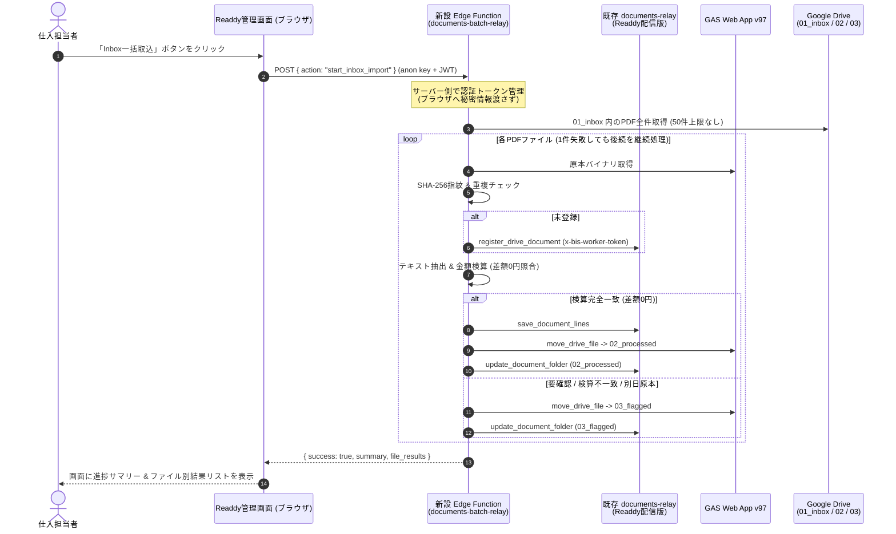

# Readdy 画面連携契約: Google Drive Inbox 一括取込 (READDY_INBOX_IMPORT_CONTRACT.md)

B.I.S EC 管理画面（Readdy）から、Google Drive の `01_inbox` フォルダ内に配置された仕入原本（PDF）を、ワンクリックでまとめて書類台帳へ取り込むための画面連携仕様書です。

---

## 1. アーキテクチャとセキュリティ原則



### セキュリティ・権限原則
- **ブラウザへの秘密情報完全遮蔽**: ブラウザは標準の Supabase クライアント（`anon key` + JWT）のみを使用します。`service_role`、`GAS_ADMIN_SECRET`、`DOCUMENTS_WORKER_SECRET` はサーバー側の Edge Function 環境変数内に厳格に隔離されます。
- **既存配信の保護**: 稼働中の `documents-relay`（Readdy配信版）のコードは一切上書き・再配信しません。本一括機能は独立した `documents-batch-relay` として新設されます。
- **PC不要の自律稼働**: クラウド上の Edge Function および GAS Web App 経由で実行されるため、担当者や開発者のPCがオフラインであってもサーバー上で完走します。

---

## 2. API エンドポイント仕様 (`documents-batch-relay`)

### (1) 一括取込の実行: `start_inbox_import`

`01_inbox` フォルダ内のPDFを全件検知し、順次解析・検算・移動・台帳登録を実行します。

- **メソッド**: `POST`
- **関数名**: `documents-batch-relay`
- **リクエスト本文**:
  ```json
  {
    "action": "start_inbox_import",
    "max_files": 50,
    "dry_run": false
  }
  ```
  - `max_files` (number, 任意): 1回の実行で処理する最大ファイル数（既定値: 50）。
  - `dry_run` (boolean, 任意): `true` の場合、Drive移動やDB書き込みを行わずシミュレーション結果のみを返します。

- **成功時レスポンス (HTTP 200)**:
  ```json
  {
    "success": true,
    "action": "start_inbox_import",
    "dry_run": false,
    "summary": {
      "total_detected": 3,
      "processed_count": 1,
      "flagged_count": 1,
      "skipped_count": 0,
      "error_count": 1
    },
    "file_results": [
      {
        "file_id": "1FcIVewPALGh-5B2iVTAJsBw1WJgBfwMb",
        "file_name": "566-20260108-20260111-10773.pdf",
        "status": "processed",
        "document_id": "6d0c89dd-ff24-4194-91d0-4eb674bc7437",
        "supplier_name": "NET JAPAN",
        "document_number": null,
        "declared_net_amount": 3071479,
        "calculated_total": 3071479,
        "discrepancy": 0,
        "lines_count": 14,
        "is_balanced": true,
        "needs_review_reasons": [],
        "error": null
      },
      {
        "file_id": "1HMtorGUBaUdTafhiYswWxywtGcZKkVsl",
        "file_name": "11.30.pdf",
        "status": "flagged",
        "document_id": "443dcbd8-605a-4c64-9496-5dc85d5be6a2",
        "supplier_name": "UNKNOWN",
        "document_number": null,
        "declared_net_amount": 0,
        "calculated_total": 0,
        "discrepancy": 0,
        "lines_count": 0,
        "is_balanced": false,
        "needs_review_reasons": ["UNKNOWN_SUPPLIER_FORMAT"],
        "error": null
      },
      {
        "file_id": "error-file-id-example",
        "file_name": "corrupt_data.pdf",
        "status": "error",
        "document_id": null,
        "supplier_name": null,
        "document_number": null,
        "declared_net_amount": null,
        "calculated_total": null,
        "discrepancy": null,
        "lines_count": 0,
        "is_balanced": false,
        "needs_review_reasons": [],
        "error": "Simulated network timeout during binary download"
      }
    ]
  }
  ```

### (2) 取込状態・サマリー取得: `get_inbox_import_status`

現在のフォルダ設定と台帳の全体サマリーを取得します。

- **メソッド**: `POST`
- **関数名**: `documents-batch-relay`
- **リクエスト本文**:
  ```json
  {
    "action": "get_inbox_import_status"
  }
  ```

- **成功時レスポンス (HTTP 200)**:
  ```json
  {
    "success": true,
    "action": "get_inbox_import_status",
    "folders": {
      "inbox_folder_id": "1ctLRUQbwINARCDuGdYnpkrCkkK287HV5",
      "processed_folder_id": "1MUpsttOl2MY1Q8QAptSX_1vBGjl_aXY3",
      "flagged_folder_id": "1kgnzKvslB0J2Mq8ZM8-PqsTjret1CQ3E"
    },
    "document_ledger_summary": {
      "total_documents": 6,
      "processed_count": 4,
      "flagged_count": 2,
      "pending_count": 0
    }
  }
  ```

---

## 3. ファイル別の判定ステータスとUI表示ルール

| `status` | 意味 | 原本Drive所在 | DBステータス | UI表示推奨 |
| :--- | :--- | :--- | :--- | :--- |
| `processed` | **正常取込完了**<br/>(差額0円一致・明細全行登録) | `02_processed` | `processed` | 緑バッジ「完了」<br/>登録行数・総額を表示 |
| `flagged` | **要確認・隔離**<br/>(未知書式・別日原本・検算不一致) | `03_flagged` | `pending_amount`※ | 黄バッジ「要確認」<br/>不一致差額または理由を表示 |
| `skipped` | **スキップ**<br/>(既に取込完了済みの同一原本) | `02_processed` | `processed` | 灰バッジ「処理済」 |
| `error` | **通信・一時エラー**<br/>(途中で例外発生。Inboxに保持) | `01_inbox` | 未登録または`pending_amount` | 赤バッジ「未完了」<br/>再試行ボタンを案内 |

> [!IMPORTANT]
> **要確認原本のDBステータスについて**:
> 現行の Readdy 配信版 `documents-relay` の契約により、要確認原本の DB `status` 列は登録初期値 `pending_amount` のままとなります。
> 要確認であることの確実な判定は、**`drive_folder_id` が `03_flagged`（`1kgnzKvslB0J2Mq8ZM8-PqsTjret1CQ3E`）を指していること**をもって行ってください。

---

## 4. Readdy 画面側での実装方法 (コード例)

提供されている [`driveBatchImportApi.ts`](file:///c:/Users/aij/Documents/bis-ec-frontend-drive-import/src/pages/documents/lib/driveBatchImportApi.ts) を使用して、簡単に画面コンポーネントへ組み込めます。

```tsx
import React, { useState } from "react";
import { startInboxBatchImport, type StartBatchImportResponse } from "../lib/driveBatchImportApi";

export const BatchImportButton: React.FC<{ onComplete?: () => void }> = ({ onComplete }) => {
  const [loading, setLoading] = useState(false);
  const [result, setResult] = useState<StartBatchImportResponse | null>(null);

  const handleStartImport = async () => {
    setLoading(true);
    try {
      const res = await startInboxBatchImport({ maxFiles: 50 });
      setResult(res);
      if (onComplete) onComplete();
    } catch (err: any) {
      alert(`取込処理エラー: ${err.message}`);
    } finally {
      setLoading(false);
    }
  };

  return (
    <div>
      <button onClick={handleStartImport} disabled={loading} className="btn-primary">
        {loading ? "取込処理中..." : "Drive Inboxを一括取込"}
      </button>

      {result && (
        <div className="mt-4 p-4 border rounded">
          <h4>取込結果サマリー</h4>
          <p>検出: {result.summary.total_detected}件 | 完了: {result.summary.processed_count}件 | 要確認: {result.summary.flagged_count}件 | エラー: {result.summary.error_count}件</p>
          <ul>
            {result.file_results.map(f => (
              <li key={f.file_id}>
                [{f.status.toUpperCase()}] {f.file_name} {f.error ? `(${f.error})` : ""}
              </li>
            ))}
          </ul>
        </div>
      )}
    </div>
  );
};
```

